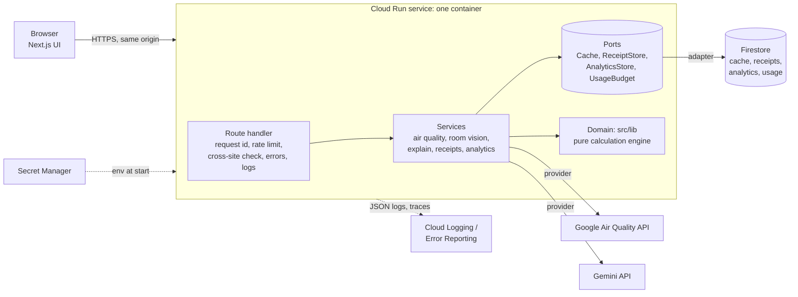

# VayuShift: backend architecture

This document explains how the server side is built, why, and what it does when things go wrong. The
audience is an engineer who has to run, change or extend it.

## 1. Shape of the system



Three layers, with dependencies pointing inward only:

| Layer | Where | Rule |
| --- | --- | --- |
| **Domain** | `src/lib` | Pure functions and constants. No I/O, no framework, no clock. All health and emission maths lives here. |
| **Server** | `src/server` | Services depend on **ports** (interfaces). **Adapters** implement them. `container.ts` is the only file that knows which adapter is used. |
| **Delivery** | `src/app`, `src/components` | Next.js routes and UI. Routes are thin: parse, call a service, shape the response. |

### Why one deployable, not microservices

There are three small endpoints behind one UI. Splitting them into separately deployed services would add
network hops (latency and failure modes), service-to-service authentication, and several release pipelines,
for no benefit at this size. The design instead keeps the *seams* where a split would happen:

- Each service talks only to ports and providers, never to `Request` or Next.js types.
- Providers (`GeminiProvider`, `GoogleAirQualityProvider`) and stores are injected, so a service can be moved.
- The obvious first extraction is **room vision**: it is the slowest and costliest call and benefits from its
  own scaling and IAM. To do it, run `RoomVisionService` in a second Cloud Run service (private, called with a
  Google-signed ID token) and replace `RoomVisionProvider` with an HTTP client. Nothing else changes.

## 2. A request, end to end

`defineRoute` (`src/server/http/handler.ts`) wraps every route so none of this is repeated:

1. Assign a **request id** (kept if the caller's is well-formed) and a child logger carrying route, request id
   and Cloud Trace id.
2. Work out the **client address** for rate limiting (see 6.2).
3. Refuse **cross-site browser requests** on cost-bearing routes (`Sec-Fetch-Site: cross-site`).
4. Apply the per-route **rate limit**, returning `429` with `Retry-After`.
5. Run the route. Bodies are read with `readJson`, which enforces the size cap on the *stream*.
6. Convert any error to the **uniform envelope** `{ "error": { code, message, requestId } }`. Internal errors
   are logged in full and returned as a generic message.
7. Add `X-Request-Id`, `Server-Timing` and `Cache-Control: no-store` (unless the route set caching), and write
   one access-log line.

## 3. Services

| Service | Responsibility | Protections |
| --- | --- | --- |
| `AirQualityService` | Hourly PM2.5 forecast for a location | Cache keyed by ~550 m grid cell; request coalescing; daily budget; stale-if-error; demo fallback |
| `RoomVisionService` | Photo to room description | Daily budget; every failure degrades to manual sliders |
| `ExplainService` | Plain-language receipt explanation | Server computes every number; number guard; cache by receipt hash; budget; template fallback |
| `ReceiptService` | Shareable immutable receipts | CSPRNG ids; server-side computation; name validation; expiry; no personal data |
| `AnalyticsService` | Anonymous product counters | Closed event schema; daily counters only; honours GPC / DNT |

**Air quality details.** Locations are snapped to a 0.005 degree cell; the upstream is queried at the cell
*centre*, so a cached answer never carries any user's point. Concurrent misses for one cell share one upstream
call. If the upstream fails or the budget is spent, a recent cached forecast is served (**stale-if-error**),
then the demo curve. It deliberately does not use stale-while-revalidate: Cloud Run throttles CPU after a
response is sent, so a background refresh cannot be relied on.

## 4. Data model (Firestore, Native mode)

All access is from the server through IAM; nothing is exposed to client SDKs (keep the database in locked
mode). No composite indexes are needed.

| Collection / document | Fields | Lifetime |
| --- | --- | --- |
| `cache/{sha256(key)}` | `key`, `json` (value as text), `storedAt`, `expiresAt` (Timestamp) | TTL policy on `expiresAt` |
| `receipts/{id}` | `createdAt`, `expiresAt` (Timestamp), `engineVersion`, `scenarioName`, `hourly[24]`, `profile`, `interventions`, `receipt` | TTL policy on `expiresAt`; also enforced on read |
| `analytics/{day}__{hash}__{shard}` | `day`, `key` (`event:dimension`), `count` | Kept (a few hundred tiny documents a day at most) |
| `usage/{day}:{resource}` | `day`, `resource`, `used`, `updatedAt` | Kept (one document per resource per day) |

- **Why JSON text in `cache`:** Firestore rejects nested arrays, and forecasts and scenarios contain them.
- **Sharded counters:** a Firestore document sustains about one write a second. Each analytics counter is split
  over 5 shard documents and summed on read.
- **Receipts store no personal data**: a scenario name (validated against a strict pattern, so coordinates
  cannot be smuggled in), an hourly series, household sizes and switches, and the computed receipt.

## 5. Cost and quota control

Two paid or quota-limited upstreams (Gemini, Air Quality) sit behind a **daily budget** in Firestore.

- An instance reserves a *block* of 10 calls in a transaction and spends it locally, so there is roughly one
  write per 10 calls, and the cap can never be exceeded. Reservations are single-flight per resource.
- When a cap is spent it is remembered, so later calls skip Firestore entirely.
- **Fail closed:** if Firestore is unreachable, paid calls are refused and users get the free fallbacks. An
  outage cannot become a bill.
- Defaults (per UTC day): Air Quality 20,000; Gemini vision 300; Gemini explain 2,000. Override with
  `BUDGET_*_DAILY`; `0` switches an upstream off.
- Caching removes most calls: the forecast cache (shared across instances), and the explanation cache (one model
  call per distinct receipt).

## 6. Security model

| Threat | Mitigation |
| --- | --- |
| Rate-limit bypass by forging `X-Forwarded-For` | The client address is read from the **right** of the header, skipping `TRUSTED_PROXY_HOPS` trusted proxies. IPv6 clients are grouped by /64. |
| Another website spending our quota through a visitor's browser | `Sec-Fetch-Site: cross-site` is refused on cost-bearing routes. |
| Oversized or endless uploads | `Content-Length` is checked, then the stream is cut off at the cap; the image is also checked by signature and capped at 5 MB. |
| Model output as an attack vector | Schema-constrained, then re-validated and clamped; free text is stripped and length-limited; the prompt tells the model to ignore text in images. |
| Hallucinated health figures | The model never calculates. The server recomputes every number and rejects any explanation containing a number the engine did not produce. |
| Secret leakage | Keys live in Secret Manager and arrive as environment variables. The Air Quality key is sent in a header, not a URL. Upstream error bodies are never returned. The logger redacts keys named `key`, `token`, `secret`, `authorization`, `cookie`, `password`, `credential`. |
| Guessing or enumerating share links | 10 characters from a 62-letter alphabet drawn from a CSPRNG (about 59 bits); malformed ids never reach the database. |
| Tracking | Counters only; no ids, IPs or user agents; GPC and Do Not Track are honoured in the browser *and* on the server. |
| Over-privileged workloads | The runtime account has only Firestore data access and read access to two named secrets. Deployment uses Workload Identity Federation limited to this repository: no stored keys. |
| Bad configuration reaching users | `loadConfig` validates everything at start-up and reports all problems together; in production the process exits, so the revision never receives traffic. |

### 6.1 Limits you should know about

- **Rate limits are per instance** (in memory). They blunt abuse; the **daily budget** is what protects spend.
  For volumetric attacks, put Cloud Armor in front (needs an external HTTPS load balancer; then set
  `TRUSTED_PROXY_HOPS=2`).
- **The number guard checks that a number exists in the computed set, not that it is attached to the right
  quantity.** A model that reuses a real number for the wrong claim would pass. The prompt and the low
  temperature reduce this; the guard removes invented figures.
- **Share links are bearer links**: anyone who has one can view it. They hold no personal data and expire.

## 7. Observability

- **Logs** are JSON on stdout (Cloud Run ships them): `severity`, `message`, `route`, `requestId`, status,
  `durationMs`, and `logging.googleapis.com/trace` when `GOOGLE_CLOUD_PROJECT` is set, which links every line to
  its request in Cloud Trace. **Cloud Run does not set `GOOGLE_CLOUD_PROJECT` for you**; the deploy workflow does.
- **Errors**: `ERROR` entries carry the Error Reporting type and a stack trace, so they are grouped in Error
  Reporting automatically. Wrapped errors log their cause.
- **Health**: `GET /api/healthz` (liveness: touches no dependency, so an outage elsewhere never restarts the
  container) and `GET /api/readyz` (readiness: pings Firestore, reports which upstreams are configured as
  booleans, returns `503` when storage is unreachable). Point an uptime check at `/api/readyz`.
- **Suggested alerts**: error-log rate, `5xx` rate, p95 latency, and a Cloud Billing budget alert.

## 8. Failure modes

| What fails | What the user sees | What the system does |
| --- | --- | --- |
| Air Quality API down or slow (6 s timeout) | Recent forecast, else demo curve | Stale-if-error, then demo; logged as a warning |
| Air Quality budget spent | Same | Serves cached or demo; no upstream call |
| Gemini down, slow (8 s) or over budget | Template explanation; sample rooms and sliders | Fallback; logged |
| Model returns an invented number | Template explanation | Rejected by the number guard |
| Firestore cache unreachable | Nothing (slightly slower) | Cache read failure is treated as a miss |
| Firestore unreachable, budget | Free fallbacks only | **Fail closed** on paid calls |
| Firestore unreachable, share links | "Share links are temporarily unavailable" (`503`) | Cause logged |
| Firestore unreachable, analytics | Nothing | Warning logged; request still `204` |
| Bad config on deploy | Old revision keeps serving | New revision exits and fails its startup check |
| Instance restarts | Nothing | State is in Firestore; in-memory caches refill |

## 9. Deployment (Cloud Run)

One-time setup: `infra/setup.sh` (APIs, Firestore, TTL policies, runtime and deploy accounts, secrets, Workload
Identity Federation). Then `.github/workflows/deploy.yml` builds from the `Dockerfile` and deploys.

Settings and why:

| Setting | Value | Reason |
| --- | --- | --- |
| Region | `asia-south1` (Mumbai) | Closest to Delhi-NCR users |
| Min / max instances | 0 / 10 | Scale to zero when idle; cap the blast radius of a spike |
| Concurrency | 80 | Requests are I/O-bound; one instance serves many |
| CPU / memory | 1 / 512 Mi | Next standalone server plus the Firestore client fit comfortably |
| Request timeout | 30 s | Longest upstream call is 8 s |
| CPU throttling | on | Cheapest; nothing relies on background work after a response |
| Startup | `register()` validates config | A bad revision never gets traffic |

Required environment (see `.env.example`): `STORAGE_BACKEND=firestore`, `GOOGLE_CLOUD_PROJECT`, `PUBLIC_ORIGIN`;
secrets `GEMINI_API_KEY`, `GOOGLE_MAPS_API_KEY`.

## 10. Testing strategy

| Level | What | Where |
| --- | --- | --- |
| Unit | Engine, palettes, validation, config, logger, clientIp, rate limiter | `src/lib/*.test.ts`, `src/server/**/*.test.ts` |
| Service | Each service against fake providers and memory storage | `src/server/services/*.test.ts` |
| Adapter logic | Firestore adapters against an in-memory Firestore fake | `src/server/adapters/firestore/*.test.ts` |
| Contract | One suite every storage adapter must pass | `storage.contract.test.ts` (memory always; Firestore when `FIRESTORE_EMULATOR_HOST` is set) |
| Route | Every endpoint through the real handler | `src/app/api/routes.test.ts` |
| Container | Image builds, health endpoints answer, a bad config stops it | CI job `container` |

**What has and has not been exercised.** The memory adapter, services, handler and routes are tested
locally. The Firestore adapters' *logic* is tested against a fake; their behaviour on **real Firestore** is
covered by the contract suite, which runs in CI against the emulator. The Google Air Quality and Gemini
adapters are tested against faked HTTP and SDK boundaries, **not against the live APIs**. The deploy pipeline
and `infra/setup.sh` have not been run against a real project.

## 11. Local development

```bash
npm run dev                      # memory storage; works with no keys and no database
npm run test:emulator            # contract tests against Firestore (needs the emulator)

# With the Firestore emulator (Google Cloud CLI + Java):
gcloud emulators firestore start --host-port=127.0.0.1:8080
FIRESTORE_EMULATOR_HOST=127.0.0.1:8080 STORAGE_BACKEND=firestore npm run dev
```

## 12. Reasonable next steps

- Stream analytics to BigQuery (Firestore export) for dashboards, or add an authenticated admin read endpoint.
- Batch client-side events to cut analytics writes.
- A shared rate limiter (Cloud Armor, or a Redis instance) if abuse appears.
- Cloud Run Jobs for scheduled cleanup, if retention rules grow beyond TTL policies.
